# Architecture

This document records what the Running Coach App is made of; the scope it serves is [the product vision](../product-vision.md).

## Drivers

- **Business goals:** [the threshold of success](../threshold-of-success.md) holds the goals the architecture serves.
- **Constraints:** the product vision's [constraints section](../product-vision.md#constraints) holds the conditions the architecture lives inside.
- **Functional requirements:** the [functional requirements index](../functional-requirements/README.md) holds the behavior the architecture must deliver.
- **Quality requirements:** the [quality requirements index](../quality-requirements/README.md) holds the quality the architecture must meet, and it is also the priority matrix.

## Container View

The product genuinely runs as one container, the phone application below, and [`ADR-001`](adr/ADR-001.md) decides that and the stack it runs on. The three platform capabilities beside it are external systems the container exchanges data with, not parts the team deploys.

### Container Responsibilities

| Container   | Responsibilities                                                                                                                                                                                                 |
| ----------- | ------------------------------------------------------------------------------------------------------------------------------------------------------------------------------------------------------------- |
| `coach app` | Owns the running session and everything about it: whether it is running, its kind, its elapsed time, and the last distance it was given; decides which line is due and when; turns a transcribed question into the stats it asks for; takes the runner's start, stop, and ask controls without the screen |

## Diagrams And Legends

Every diagram in this document follows these conventions.

- A **rectangle inside the product boundary** is a container the team deploys: an application or a data store that has to be running for the product to work.
- A **rectangle outside the boundary** is an external system the product exchanges data with and does not deploy.
- The **dashed box labelled "Boundary of the product"** encloses what the team ships.
- An **arrow** carries data in the direction it points, and its label says what crosses it.
- The second line of a container's label is its technology.

The tool is [Mermaid](https://mermaid.js.org/), rendered with [mermaid-cli](https://github.com/mermaid-js/mermaid-cli).

| Image                          | Source                               |
| ------------------------------ | ------------------------------------ |
| [container.svg](container.svg) | [container.mmd](container.mmd)       |

The system context diagram, which shows the runner and the other actors around the product, stays in the product vision under [its context section](../product-vision.md#context), with its own source beside it.

## Architectural Decisions

One row per record. `Proposed` and `Accepted` are active; `Superseded`, `Deprecated`, and `Dropped` are not. Active rows come first, in `ADR-nnn` order.

| ADR                      | Status   | Addresses                                                                                                                                                                                                                                                                                                                                                        | Decision                                                            |
| ------------------------ | -------- | ------------------------------------------------------------------------------------------------------------------------------------------------------------------------------------------------------------------------------------------------------------------------------------------------------------------------------------------------------------- | ------------------------------------------------------------------- |
| [ADR-001](adr/ADR-001.md) | Accepted | [`FR-001`](../functional-requirements/fr/FR-001.md), [`FR-002`](../functional-requirements/fr/FR-002.md), [`FR-006`](../functional-requirements/fr/FR-006.md), [`QR-01`](../quality-requirements/qr/QR-01.md), [`QR-03`](../quality-requirements/qr/QR-03.md), [`QR-04`](../quality-requirements/qr/QR-04.md)                                                     | One Android application, holding the session in memory               |
| [ADR-002](adr/ADR-002.md) | Accepted | [`FR-002`](../functional-requirements/fr/FR-002.md), [`FR-003`](../functional-requirements/fr/FR-003.md), [`QR-01`](../quality-requirements/qr/QR-01.md), [`QR-04`](../quality-requirements/qr/QR-04.md)                                                                                                                                                          | The Android platform text-to-speech engine                           |
| [ADR-003](adr/ADR-003.md) | Accepted | [`QR-01`](../quality-requirements/qr/QR-01.md), [`QR-02`](../quality-requirements/qr/QR-02.md), [`FR-002`](../functional-requirements/fr/FR-002.md), [`FR-003`](../functional-requirements/fr/FR-003.md), [`FR-006`](../functional-requirements/fr/FR-006.md)                                                                                                     | A pure Kotlin engine the service drives                              |
| [ADR-004](adr/ADR-004.md) | Accepted | [`FR-004`](../functional-requirements/fr/FR-004.md), [`FR-005`](../functional-requirements/fr/FR-005.md), [`QR-01`](../quality-requirements/qr/QR-01.md), [`QR-03`](../quality-requirements/qr/QR-03.md)                                                                                                                                                          | An on-device model for intent, with keyword matching behind it       |
