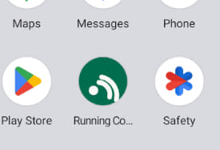
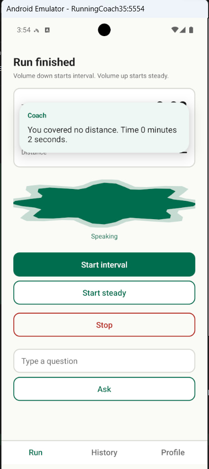
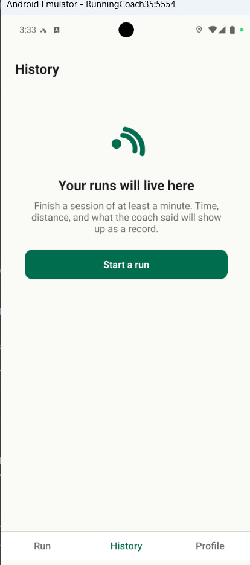
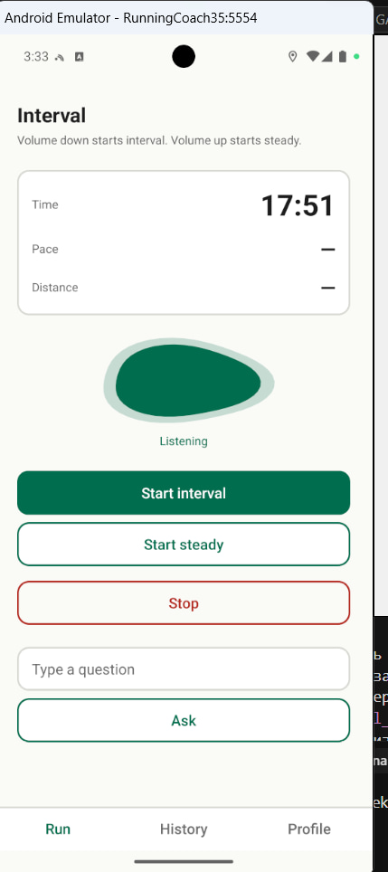

# Week 5 validation meeting report

## Metadata

- **Date:** 2026-10-31
- **Duration:** about 23 minutes
- **Attended:** Ezekiel-Gadzama, sirjaey, ObeTech1, Customer
- **Presented:** screenshots of the run screen with live stats and the spoken-line overlay, the empty History tab, and Profile. The production deployment on the university VM was not shown. The quality requirements index, the testing plan, and the architectural decision records were not shown.
- **Recording:** permitted — the `Customer` ran the recording and said he would post it.
- **Transcript publication:** script questions 1 to 3 were not asked separately; the team publishes a sanitized transcript in this repository from the recording the `Customer` supplied.
- **Transcript shared privately:** script question 3 was not asked separately.
- **Transcript:** [meeting-transcript.md](meeting-transcript.md)
- **Script:** [meeting-script.md](meeting-script.md)

The screenshots sent in the meeting:

## Previous action points

| Action | Outcome | Decision |
| --- | --- | --- |
| [`reports/week-04/meeting-report.md`](../week-04/meeting-report.md#action-points): "Build the app from the repository, install it on the `Customer`'s phone, and confirm pocket and Bluetooth headset use" | Not carried out: the `Customer` has still not installed. He said it is more involved than he expected and that he will install, hopefully this weekend. Pocket and headset use on his device remain unconfirmed. Tracked earlier under [#86](https://github.com/Running-Coach-App/running-coach-app/issues/86). Re-listed below. | None |
| [`reports/week-04/meeting-report.md`](../week-04/meeting-report.md#action-points): "Show elapsed time, pace, and distance on screen while the coach speaks them" | Carried out in [#130](https://github.com/Running-Coach-App/running-coach-app/issues/130) / [#131](https://github.com/Running-Coach-App/running-coach-app/pull/131). Shown in this meeting as screenshots. The `Customer` said it looks pretty good, then asked for the Run heading to match the tab, for Interval and Steady without the word Start, and for the stats to appear without a typed Ask box. | [DEC-024](../../docs/decisions.md#dec-024), [DEC-025](../../docs/decisions.md#dec-025), [DEC-026](../../docs/decisions.md#dec-026), [DEC-029](../../docs/decisions.md#dec-029) |
| [`reports/week-04/meeting-report.md`](../week-04/meeting-report.md#action-points): "Run script questions 14 to 16 and the quality-requirements and architecture sections at the next customer meeting" | Partial. Quality was asked in this meeting and answered as Play Store publishing rules that fit the course, plus a repository security scanner. Script questions 15 to 17 of [this week's script](meeting-script.md) — the two presets, professional runners, and the wearable — were not asked. The architecture pages were not shown. The three unasked questions are re-listed below. | [DEC-027](../../docs/decisions.md#dec-027) |

## Previous open questions

| Question | Answer | Decision |
| --- | --- | --- |
| [`reports/week-04/meeting-report.md`](../week-04/meeting-report.md#open-questions): "Are professional runners in scope later?" | Not asked. Re-listed below. | None |
| [`reports/week-04/meeting-report.md`](../week-04/meeting-report.md#open-questions): "What does a wearable add, and should any remaining week go to one?" | Not asked. Re-listed below. | None |
| [`reports/week-04/meeting-report.md`](../week-04/meeting-report.md#open-questions): "Do the two presets still follow this coach, or do they leave the plan?" | Not asked. Re-listed below. | None |
| [`reports/week-04/meeting-report.md`](../week-04/meeting-report.md#open-questions): "Which quality requirement would the `Customer` drop or replace?" | Answered: do not invent a private quality set. Take Play Store publishing rules that fit the remaining weeks, and add a repository scanner for vulnerabilities and dependencies. | [DEC-027](../../docs/decisions.md#dec-027) |
| [`reports/week-04/meeting-report.md`](../week-04/meeting-report.md#open-questions): "Which architectural decision is most likely wrong later?" | Not asked as a walkthrough of the records. He separately refused accounts and servers and asked for on-device history with a file export, which supports [ADR-001](../../docs/architecture/adr/ADR-001.md) rather than reversing it. Re-listed below as the export shape, not as a new architecture review. | [DEC-028](../../docs/decisions.md#dec-028) |

## Summary

- The `Customer` has still not installed from the repository. Screenshots of the on-screen stats, the spoken overlay, History, and Profile were sent on Telegram; he said posting in the channel is fine, and that the screens look pretty good.
- He asked for the Run heading to match the Run tab, for Interval and Steady without the word Start, for the stats to show without being asked, and for Ask to become a microphone on/off control so the app is not listening while he talks to someone.
- He left the product name and logo with the team.
- Quality should follow Play Store publishing rules that fit the course, plus a security and dependency scanner in the repository that he can run himself.
- Sign-in, sign-up, and a remote database are out of scope. Runs stay on the device; a later export and import, for example comma-separated values, is preferred over any server. He welcomed a student runner trying the app next week.

## Story verdicts

| Story | Verdict | Decision |
| --- | --- | --- |
| [US-02](https://github.com/Running-Coach-App/running-coach-app/issues/38) on-screen stats / [FR-010](../../docs/functional-requirements/fr/FR-010.md) | Accepted as a first iteration from screenshots, with the heading, session labels, always-visible stats, and microphone changes below. Acceptance criteria were not walked one at a time on his phone. | [DEC-029](../../docs/decisions.md#dec-029) |
| [US-10](https://github.com/Running-Coach-App/running-coach-app/issues/141) | Seen: he understood the empty History state once Run was highlighted. He did not reject History. The story was not shown against its acceptance criteria, so it stays open. | None |
| [US-01](https://github.com/Running-Coach-App/running-coach-app/issues/37) on his device | Not shown. He has not installed, so pocket start and stop on his phone remain unvalidated. | None |

## Decisions

- [DEC-023: Leave the product name and the logo with the team.](../../docs/decisions.md#dec-023)
- [DEC-024: Title the run screen Run, matching the selected tab, and show the session kind separately.](../../docs/decisions.md#dec-024)
- [DEC-025: Label the session actions Interval and Steady, without the word Start.](../../docs/decisions.md#dec-025)
- [DEC-026: Show time, pace, and distance without a typed question, and replace Ask with a microphone on/off control.](../../docs/decisions.md#dec-026)
- [DEC-027: Take the product's quality bar from Play Store publishing rules that fit the remaining weeks, and add a repository security scanner the Customer can run.](../../docs/decisions.md#dec-027)
- [DEC-028: Keep finished runs on the device; do not add an account or a server; prefer a file export later.](../../docs/decisions.md#dec-028)
- [DEC-029: Treat the on-screen first iteration as good enough to continue, with the labelling and microphone changes above.](../../docs/decisions.md#dec-029)

## Action points

| Action | Owner | Due |
| --- | --- | --- |
| Title the run screen Run, label the session actions Interval and Steady without Start, show time, pace, and distance without a typed question, and replace Ask with a microphone on/off control | Ezekiel-Gadzama | 2026-11-07 |
| Choose the Play Store publishing rules that fit the remaining weeks, and add a repository scanner for vulnerabilities and package dependencies that a stranger can run | sirjaey | 2026-11-07 |
| Build the app from the repository, install it on the `Customer`'s phone, and confirm pocket and Bluetooth headset use | `Customer` | 2026-11-07 |
| Ask the carried questions on the two presets, professional runners, and the wearable | Ezekiel-Gadzama | 2026-11-07 |
| Put the app in front of a student who runs and bring that feedback to the next customer meeting | Ezekiel-Gadzama | 2026-11-14 |

## Open questions

| Question | What it would change | Follow-up |
| --- | --- | --- |
| Are professional runners in scope later? | Whether anything built now must generalise to faster runners | Next customer meeting — script question 16 |
| After using the app, is heart rate still worth a week of the ones that are left? | Whether [US-07](https://github.com/Running-Coach-App/running-coach-app/issues/43) enters the remaining plan | Next customer meeting — script question 17 |
| Do the two preset sessions still follow this coach, or have they left the plan? | Build order after the pocket coach, and [US-06](https://github.com/Running-Coach-App/running-coach-app/issues/42) | Next customer meeting — script question 15 |
| May Android `SpeechRecognizer` send spoken audio off the device? | Whether [US-04](https://github.com/Running-Coach-App/running-coach-app/issues/40) still matches [DEC-004](../../docs/decisions.md#dec-004) | Next customer meeting. The platform recogniser is created in `CoachService.kt`. |
| What file shape should a later export and import use besides comma-separated values? | The export work that [DEC-028](../../docs/decisions.md#dec-028) prefers over a server | Next increment after the microphone and labelling changes |

## Disagreements

| Your position | Customer's position | What you changed |
| --- | --- | --- |
| A typed Ask box is a way to try spoken questions while the screen is open | If stats are the only answer, show them; replace Ask with a microphone on/off so he can stop the app listening | Recorded as [DEC-026](../../docs/decisions.md#dec-026) |
| Sign-in, sign-up, and a database would keep history across devices | Store runs on the device; deleting the app may drop them; export and import later; no servers | Recorded as [DEC-028](../../docs/decisions.md#dec-028) |
| The run heading can show Interval or Steady as the mode | The heading should say Run, like History and Profile, with the session kind elsewhere | Recorded as [DEC-024](../../docs/decisions.md#dec-024) and [DEC-025](../../docs/decisions.md#dec-025) |

## Deviations

1. **Script questions 1 to 3 were not asked in the planned order.** The `Customer` recorded the call and later said he would post the recording; publication of a sanitized transcript was not put as a separate yes or no.
2. **The meeting did not follow the Week 5 agenda.** Questions 4 to 7 about his own run could not be asked, because he has not installed. Questions 9 and 11 to 17 of [the script](meeting-script.md) were not asked in the scripted form. The quality requirements index, the testing plan, and the milestones were not shown.
3. **The product shown was screenshots of a local build, not production on the university VM.** Assignment 5 asked for the deployed production instance from the university network. The VM was not available, so this is the fallback the assignment names: show the local product and declare the deviation.
4. **Finished stories were not walked against each `AC-nn` on his device.** Verdicts rest on screenshots and on what he said about them.
5. **ObeTech1 joined after the product discussion**, because of an electricity and connection failure, and had no questions.
